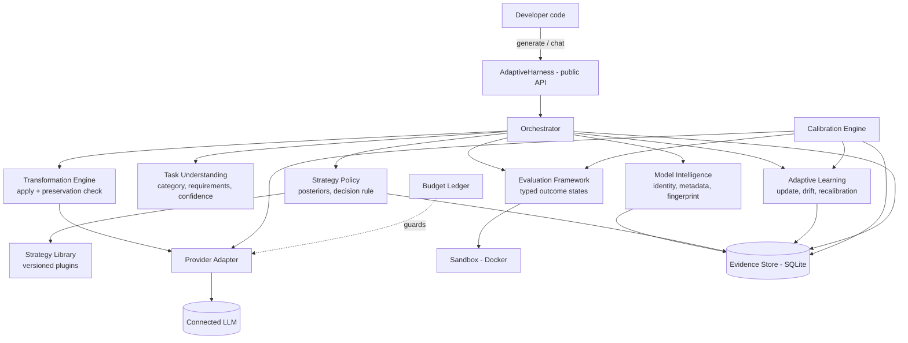
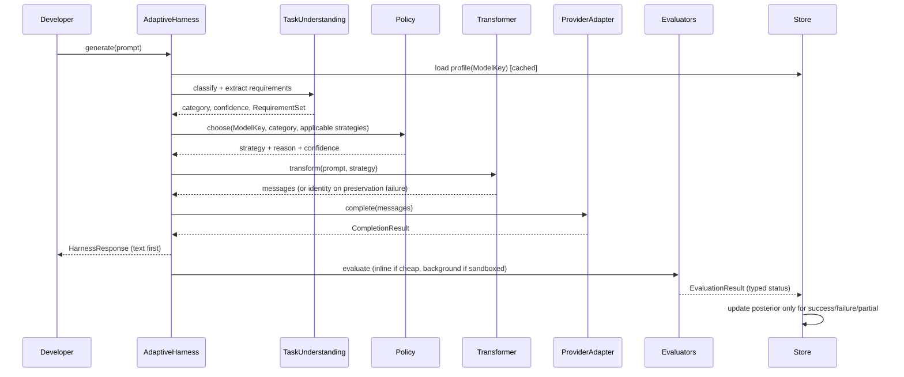
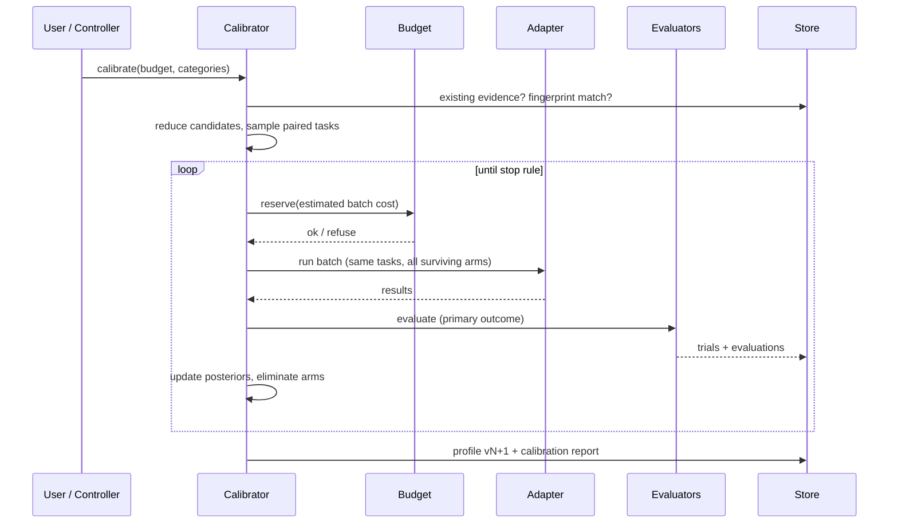
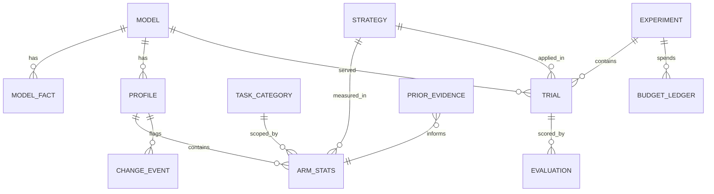

# Adaptive Prompt Harness: technical design (Phase 1)

Status: **draft for approval**, 2026-11-10. Nothing in this document is implemented yet.
Target repository: `github.com/ayushiii2707/agentic-harness`. Package name (proposed): `adaptive-prompt-harness`,
imported as `adaptive_harness`.
Companion files: `docs/RELATED_WORK.md` (research and reuse), `docs/DECISIONS.md` (decision log),
`docs/DEVLOG.md` (development log).

LeBlanc v4 is **read-only reference material**. No LeBlanc code, data or database is copied into this project.
Its published findings enter only as cited prior-evidence records (section 6.6).

---

## 1. Problem statement

The same prompt does not work equally well on every LLM. Our own prior study (LeBlanc v4) measured a one-line
security instruction on 56 Python tasks. On security-test failure rate it gave −11.9 pp on one model (significant)
and no effect on another. On secure-and-working output it gave anything from −4.7 pp to +10.5 pp (not
significant). The literature agrees that prompt sensitivity is real but unpredictable (Sclar et al. 2024:
formatting alone moves accuracy by up to 76 pp). It also says that modern models may be **less** sensitive than
older studies suggest ("Flaw or Artifact?", EMNLP 2025).

Today a developer who switches models has two options. They can re-learn by hand how to prompt the new model, or
they can run a per-task optimiser (DSPy, GEPA, OPRO). Those optimisers need a training set and a metric for each
program, and they keep nothing that carries over to the developer's next, different prompt.

**The problem we solve:** given a connected model *M* and an incoming prompt *p* of task category *c*, choose a
prompt transformation *s* (possibly "send *p* unchanged") that maximises expected task success minus cost on
*M*. The choice must:
- rest on measured evidence about (*M*, *c*, *s*);
- learn that evidence with a bounded budget;
- keep adapting it as evidence arrives and as *M* changes;
- never change what *p* asks for.

**Research question for the thesis (Phase 12):** does choosing strategies per model and per task category improve
held-out task success, at acceptable token cost, over:
- (A) the original prompt,
- (B) one fixed "best practice" strategy,
- (C) per-model selection that ignores the task category?

## 2. Objectives and how we measure them

| ID | Objective | Measure | Target (to be confirmed by experiment, not promised) |
|---|---|---|---|
| O1 | Never make outcomes worse by default | Held-out success of D vs A, per model | Not significantly worse on any model (one-sided paired test) |
| O2 | Improve where the evidence supports it | Held-out success of D vs A and D vs B | Report effect and 95% CI per model × category. "No effect" is an acceptable, reportable result |
| O3 | Respect the budget | Calibration spend ≤ configured cap; no paid call without a configured budget | Hard guarantee, tested |
| O4 | Preserve intent | Requirement-coverage check pass rate; manual audit of a sample of transformations | Zero unflagged requirement drops in the audit sample |
| O5 | Low overhead | Added p50 latency, excluding model time | < 5 ms for the deterministic path; profile lookup < 1 ms (cached) |
| O6 | Survive model change | Simulated drift: detection delay and false-alarm rate | Detected within a configured window; false alarms < 5% in simulation |
| O7 | Usable package | Clean-environment install, 3-line quickstart, works with local Ollama with no paid key | Tested in CI |

## 3. Key design principles (and where each comes from)

1. **The original prompt is an arm, and it is the default.** A strategy replaces it only when its posterior
   advantage, net of cost, passes a threshold. *Source:* most LeBlanc interventions were neutral and one was
   possibly harmful; the OPTS paper's "do not modify" arm.
2. **No feedback, no learning.** A response with no evaluation never counts as a success or a failure. It is
   recorded as `no_evaluation` and does not touch the estimates. *Source:* brief §10.6.
3. **Explore only where you can observe.** Online exploration happens only on requests where an evaluator can
   score the result. *Source:* partial-feedback bandit literature (BaRP); exploring blind is pure cost.
4. **The final outcome is the metric, not an intermediate one.** Scanner-clean is not secure; parses-as-JSON is
   not correct. Each category declares a **primary outcome** evaluator. *Source:* LeBlanc Finding C.
5. **Additive before rewriting.** Version 1 strategies add structure or context around the user's text, which is
   kept verbatim. Strategies that rewrite the user's words are a separate, experimental class behind a stricter
   preservation gate. *Source:* brief §9.1, which is non-negotiable.
6. **Deterministic by default; an LLM only where its reasoning is needed.** No hidden LLM calls. Every
   auxiliary LLM call (rewriter, judge, classifier) is opt-in, budgeted and logged.
7. **Evidence has provenance.** Every number in a profile can be traced to trials, or to a cited external
   source with its conditions.

## 4. High-level architecture



**Agentic, but only where it earns its place.** The "agent" in this system is the **autonomous
calibration-and-learning controller** (section 6.5). It is a goal-directed loop that decides when to explore,
which arms to test, when evidence is enough, and when to recalibrate, all under a budget. Everything else is a
deterministic, unit-testable service. An LLM is used in three optional places only: the rewriting strategies,
the LLM judge, and the LLM task classifier. Each is a plug-in with its own budget line. We do **not** build a
multi-agent system. There is no responsibility in the brief (§12) that needs one, and every extra autonomous LLM
step would add cost, non-determinism and an injection surface.

## 5. Components

### 5.1 Model Intelligence (`models/`)

- **ModelKey** = (`provider`, `model_id`, `resolved_version`, `deployment`), where `deployment` is `hosted` or
  `local:<host>`.
  - `resolved_version` comes from what the provider *actually reports*: OpenAI-compatible `model` echo and
    `system_fingerprint`, Anthropic `model` echo, Gemini `modelVersion`, Ollama `/api/show` digest, OpenRouter
    `provider` field.
  - Aliases such as `*-latest` are marked `alias=True` and get a shorter evidence lifetime.
- **Metadata** is stored as facts, each tagged with provenance:

  | Provenance | Meaning | Example |
  |---|---|---|
  | `verified` | Read from the provider's model endpoint | context window from `/models` |
  | `provider_reported` | Returned in a response | `system_fingerprint`, serving host |
  | `inferred` | Our rule from the ID | "family = gpt-oss" |
  | `observed` | Measured by us | JSON-mode success rate, median latency |

- **Fingerprint.** A hash of (resolved_version, quantisation, serving host) where these are available. When the
  fingerprint changes, the profile is marked `stale` (section 6.7). It is not silently reused.
- No external call is made to identify a local model; Ollama, vLLM and LM Studio expose their metadata locally.

### 5.2 Task Understanding (`tasks/`)

- **Taxonomy** (versioned data file, extensible):
  - `code_generation`, `code_debugging`, `code_explanation`, `code_refactoring`, `architecture`,
    `api_development`, `data_analysis`
  - `summarisation`, `research`, `question_answering`, `math`, `structured_output`, `content_generation`,
    `security_sensitive_code`, `multi_step`
  - plus `general` as the fallback.

  Categories can be nested (e.g. `api_development` ⊂ `code_generation`), so evidence can back off to the parent.
- **Classifier v1 (deterministic).** A weighted feature model over:
  - keyword and phrase lexicons per category,
  - code fences and stack traces,
  - language names,
  - output-format cues ("return JSON", "table"),
  - question form,
  - length and enumeration.

  Output is a probability distribution plus a confidence score. **If max probability < 0.55, or the margin to
  the second category < 0.15, the category is `general`.** In that case only general-safe strategies are allowed.
  The thresholds are tuned on a labelled development set in Phase 5 and **frozen before Phase 12**.
  An optional LLM classifier plug-in is off by default.
- **Requirement extraction (deterministic):**
  - sentence- and clause-level spans with deontic markers (`must`, `should`, `only`, `do not`, `never`,
    `without`, `at least`, `exactly`),
  - numbers with units, quoted literals, code identifiers, file paths, URLs,
  - named languages and frameworks,
  - the requested output format,
  - negative instructions, kept as their own class.

  The result is a `RequirementSet` that the preservation check uses (5.4) and that some evaluators use.
- **Complexity estimate:** an ordinal low / medium / high from the number of requirements, length and
  multi-part structure. It is a context feature for the policy, not a category.
- **Evaluation suitability:** the list of evaluators that can score this request (e.g. "code with a test file
  attached" → test execution; "return JSON matching schema X" → schema validation).
- The classifier **never changes the prompt**. It only labels it.

### 5.3 Strategy Library (`strategies/`)

Each strategy is a class registered by ID, with this metadata:

| Field | Purpose |
|---|---|
| `id`, `version`, `content_hash` | Identity. Evidence is keyed by (id, version). A change in the hash invalidates evidence |
| `kind` | `identity`, `additive`, `structural`, `rewriting` (experimental) |
| `description`, `intended_use`, `limitations` | Documentation, shown in traces |
| `applies_to` | Task categories, or `*` |
| `requires` | e.g. `system_role`, `examples_available`, `schema` |
| `transform(request, task_spec) -> TransformResult` | Pure function, no I/O, except for `rewriting` strategies, which receive an injected LLM client and budget |

**Initial candidate set (v1):**

| ID | Kind | What it does |
|---|---|---|
| `identity` | identity | Sends the prompt unchanged. Always available; the default |
| `concise_directive` | additive | Adds one short line that sets the expected output form, e.g. "Answer with only the code." |
| `structured_sections` | structural | Wraps the prompt as *Task / Requirements / Constraints / Output format*. The requirement list is the user's own extracted spans, quoted, never paraphrased |
| `requirements_checklist` | additive | Appends "Make sure the answer satisfies:" followed by the extracted requirements, verbatim |
| `role_framing` | additive | Adds a system-role line suited to the category ("You are an experienced Python developer.") |
| `stepwise_plan` | additive | Asks the model to plan before the final answer, with a marked final section. Only where the output can be parsed out |
| `output_schema` | additive | States an explicit output schema when the user gave one or the category implies one |
| `security_generic` | additive | One generic security line (applies to `security_sensitive_code`, `code_*`, `api_development`) |
| `security_targeted` | additive | CWE-style warnings retrieved from the prompt. **Marked unvalidated**: retrieval accuracy is low in prior work |
| `few_shot_from_library` | additive | Adds 1–2 curated examples for the category. Never examples taken from the evaluation splits |
| `minimal_context` | rewriting (exp.) | Removes redundant boilerplate. Gated by the strict preservation check |
| `llm_rewrite` | rewriting (exp.) | An LLM rewrites the prompt for the target model. Opt-in, budgeted, strict gate |

These are **hypotheses**, not recommendations. No strategy is mapped to a model in code. Mappings appear only in
learned profiles.

### 5.4 Transformation Engine and preservation check (`transform/`)

1. The policy (6.4) chooses a strategy. The engine applies it and gets a `TransformResult`: messages, plus a
   record of which spans were added and where the user's original text sits.
2. **Structural guarantees (all kinds):**
   - The user's text is carried as a **data block** inside clear delimiters, in the user role.
   - Harness instructions go in the system or developer role, or in a clearly separated preface.
   - User text is never interpolated into an instruction template position.
   - Characters that look like delimiters are escaped.
3. **Preservation check:**
   - *Identity, additive, structural:* we verify by construction that the original text appears **verbatim** in
     the output (substring check). Added text must not contain negations of extracted requirements (a lexical
     contradiction check against the RequirementSet). The programming language and output format must not change.
   - *Rewriting:* every extracted requirement span must be covered in the rewrite (normalised token overlap ≥
     threshold, with exact match for numbers, literals and identifiers). Negative instructions must survive with
     their polarity. Length ratio must be within bounds. Optionally, an independent LLM equivalence judge
     (different model family from the target).
   - On **any** failure the engine falls back to `identity` and records `preservation_failed` with the reason.
4. **Safe fallback:** any exception in classification, policy, transformation or the store sends the original
   prompt and logs the failure. The user's call never fails because optimisation failed.
5. **Trace** (stored according to the privacy settings, section 9): original-prompt hash (or text), transformed
   prompt, ModelKey, category and confidence, strategy id and version, decision reason, posterior summary,
   preservation result, evaluation result if any.

**As implemented (Phase 8, `transform/`):**
- One engine, `apply_strategy`, is used by every request path (generate, chat, stream, calibration).
- Rules for all strategy kinds: messages other than the last user message survive unchanged and in order; no
  harness-added system message may contain the user's text.
- Identity, additive and structural strategies must keep the user's text verbatim.
- Rewriting strategies must pass `check_rewrite`:
  - every number, literal, identifier, path, URL, named language and output format is kept exactly;
  - each constraint and negative sentence keeps at least 70% of its content words, and the number of negation
    words does not drop;
  - **every** content word of the original remains (only stop words and an explicit list of pleasantries may be
    deleted);
  - the length ratio stays within 0.4–2.5.
- A word-level check cannot recognise a faithful paraphrase, so the only rewriting strategy shipped is the
  deterministic `minimal_context` (it removes greetings, thanks and politeness phrases). The planned `llm_rewrite`
  needs an independent equivalence judge first and is not implemented.
- Earlier drafts of the check allowed 10% of content words to go missing; a mutation test showed that this let a
  rewrite drop "that returns ISO dates" from a prompt, so the requirement became 100%.

### 5.5 Provider layer (`providers/`)

```python
class ProviderAdapter(Protocol):
    name: str
    def capabilities(self) -> ProviderCapabilities: ...            # roles, tools, json mode, streaming, ...
    def model_info(self, model: str) -> list[MetadataFact]: ...      # may return [] when nothing is exposed
    def complete(self, req: CompletionRequest) -> CompletionResult: ...
    async def acomplete(self, req: CompletionRequest) -> CompletionResult: ...
    def stream(self, req: CompletionRequest) -> Iterator[StreamEvent]: ...
```

- `CompletionResult` carries: text, tool calls, finish reason (normalised: `stop`, `length`, `tool`, `filtered`,
  `error`), usage (input, output and reasoning tokens, `None` where unknown, **never guessed silently**), cost
  (reported, or estimated and flagged), latency, raw provider IDs and fingerprint fields.
- **Errors are normalised** to `AuthError`, `QuotaError`, `RateLimitError` (with retry-after), `ContextLengthError`,
  `InvalidRequestError`, `ProviderUnavailable` and `MalformedResponse`. The retry policy is bounded (max attempts,
  max total wait). Only idempotent transport failures and rate limits are retried.
- **Adapters, in priority order:**
  1. `openai_compatible`. One adapter with presets for OpenAI, Groq, DeepSeek, OpenRouter, Ollama, vLLM and
     LM Studio.
  2. `anthropic` (Messages API).
  3. `gemini` (Generative Language API).

  Provider-specific fields (OpenRouter host pinning, Ollama options) stay inside adapter presets.
- **Credentials** are read from the constructor argument or from environment variables (`OPENAI_API_KEY`,
  `GROQ_API_KEY`, …). They are held in a `SecretStr`-style wrapper whose `repr` is masked, never written to the
  store, and scrubbed from exception messages and logs.
- A `MockProvider` with scripted, seeded behaviour is used for tests and for the simulation in Phase 10. Anything
  it produces is labelled `simulated` in the store, so it can never be mistaken for a real result.

### 5.6 Evaluation Framework (`evaluation/`)

```python
class Evaluator(Protocol):
    id: str; version: str
    cost_class: Literal["free", "sandboxed", "paid"]
    def applicable(self, task: TaskSpec) -> bool: ...
    def evaluate(self, task: TaskSpec, response: CompletionResult) -> EvaluationResult: ...
```

`EvaluationResult.status` is one of:
- `success`
- `failure`
- `partial` (with a score in [0, 1] and per-check details)
- `evaluation_error` (the evaluator broke, e.g. sandbox down; **never counted as a model failure**)
- `not_applicable`
- `no_evaluation`

Only `success`, `failure` and `partial` update estimates. `partial` contributes a fractional Bernoulli update and
is reported separately.

**Evaluators, in implementation order:**
1. Code extraction and syntax check (Python `compile`; `tree-sitter` optional for other languages).
2. Output-format checks (JSON parse; JSON Schema validation with `jsonschema` as an optional extra; regex and
   format constraints).
3. Verifiable-constraint checks (IFEval-style: word counts, required keywords, forbidden words, number of
   bullets).
4. Unit-test execution in the sandbox (functional tests; security tests where the task provides them).
5. Reference-based checks (exact or normalised match for math and QA).
6. Static analysis (Bandit/Semgrep, optional extra). **Never a primary outcome**; always labelled "not a
   security verdict".
7. LLM judge (opt-in, paid). It must be a different model family from the model under test, use a rubric, and
   report position-bias checks. **Never the sole primary outcome** for Phase 12 claims.
8. Human feedback: `harness.feedback(response_id, success=..., score=..., note=...)`, stored as evaluator `human`.

**Primary-outcome rule.** For calibration and research, each benchmark task declares its primary evaluator. Other
evaluators are recorded as secondary metrics.

### 5.7 Sandbox (`sandbox/`)

**Decision: Docker on macOS and Linux** (Docker Desktop, OrbStack or Colima on macOS; rootless Docker or Podman
on Linux), with **gVisor (`runsc`) used automatically when it is available** on Linux. Reasons:
- Docker works on both target platforms.
- On macOS it already runs inside a VM, which is an extra boundary.
- It is what Inspect AI and most evaluation harnesses use.
- bubblewrap is Linux-only.

Per-job container settings:
- `--network none --read-only --cap-drop ALL --security-opt no-new-privileges`
- `--pids-limit 128 --memory 512m --memory-swap 512m --cpus 1`
- `--user 65534:65534`
- `--tmpfs /tmp:size=64m --tmpfs /work:size=64m`
- no bind mounts of host paths, an empty environment, a wall-clock timeout, and forced removal afterwards.

The image is pinned by **digest** and holds only the interpreter and an allow-listed set of packages. Jobs are
sent over stdin.

**Integrity fixes** (lessons from the Phase 0 audit):
- **Results travel on a separate channel.** The trusted runner writes the result as JSON to file descriptor 3,
  together with a per-job random nonce. It closes that descriptor in the candidate's process before importing
  candidate code (test and candidate run in a child process; the parent holds the descriptor). A result with no
  valid nonce = `evaluation_error`.
- **Infrastructure failure is never a model failure.** Container start failure, a missing image, a daemon that
  is down or a killed runner → `evaluation_error`. Only a completed test with an assertion failure or a candidate
  exception → `failure`.
- **Resource limits are enforced by the container runtime, not by the untrusted process.**
- **Self-test** (`adaptive-harness sandbox-check`): network blocked, host files invisible, environment empty,
  fork bomb contained, memory bomb contained, timeout enforced, forged-result attempt detected. It runs before any
  calibration that uses execution.

**Residual risk, stated honestly:** test code and candidate code run in the same interpreter, so a deliberately
adversarial candidate can still interfere with the test's own logic. Our threat model is non-adversarial model
output plus accidental harm. Escaping to the host is what the container boundary prevents.
If Docker is unavailable, execution evaluators return `evaluation_error`. Nothing ever falls back to running on
the host.

## 6. Algorithms

### 6.1 Unit of evidence and clustering

Responses to the same task are not independent. We store every trial, but **update estimates per task**: when a
task is attempted *r* times under strategy *s*, its contribution to the posterior is the fractional update
(*k/r*, (*r−k*)/*r*). Every task therefore counts once. This is the same cluster-respecting idea as LeBlanc's
bootstrap over tasks, applied to a Bayesian estimate.

### 6.2 Performance estimate

For each cell (ModelKey, category, strategy@version) we keep a Beta(α, β) posterior over the success rate. We
also keep summaries of tokens, cost and latency (mean, p50, p90).

**Hierarchical backoff:** the prior for a (model, category, strategy) cell is formed from:
- the parent category's posterior for the same model and strategy, shrunk to an effective weight of
  *w_parent* = 4 pseudo-observations;
- otherwise the model-global posterior for the strategy (weight 2);
- otherwise a flat Beta(1, 1);
- plus any external prior evidence (6.6).

This lets sparse categories borrow strength without being overwritten by it.

**Time decay:** before each update, pseudo-counts are discounted by γ^(Δt / half-life). The default half-life is
90 days for pinned versions and 21 days for aliases. Old evidence fades instead of being trusted forever.

### 6.3 Utility and cost

utility(*s*) = P(success | *s*) − λ · E[cost(*s*)] / cost_ref.

- λ (default 0.1) is the user's "quality per dollar" knob.
- cost_ref is the identity strategy's mean cost for that cell.
- Token growth from additive strategies, *including the longer outputs they cause*, is part of the cost.
  LeBlanc measured +44% total tokens from a one-line preamble.

### 6.4 Decision rule (normal request path)

1. Candidates = the strategies applicable to the category with all requirements met, plus `identity`.
2. **Exploit mode** (default; *as implemented, revised 2026-11-10*):
   - Only strategies with at least `min_trials` (default 30) evaluated outcomes are compared, and only once
     identity also has `min_trials`.
   - Use the challenger *s\** with the highest P(θ(*s\**) > θ(identity) + δ) **only if** that probability is
     ≥ 1 − (1 − 0.90)/k, where k is the number of challengers (Bonferroni). Estimated by Monte-Carlo from the
     posteriors; δ is the minimum worthwhile gain (default 0.02).
   - Otherwise send `identity`.
   - The cost term of §6.3 is not applied yet; it needs the token/cost summaries that Phase 10 adds to
     `arm_stats`.
3. **Exploration** (opt-in, `PolicyConfig.exploration_rate`):
   - Only on calls whose outcome will be observed (the caller passed `check=`); never otherwise (principle 3).
   - With probability `exploration_rate`, the strategy is drawn **uniformly** among the candidates, identity
     included.
4. Below-threshold confidence in the task category → the candidate set shrinks to `identity` plus strategies
   marked `general_safe`.
5. Outcome signals: only a developer-supplied check (`generate(..., check=fn)`) or `feedback(response_id, ...)`
   update the evidence, at most once per response. Errors in the check are `evaluation_error` and never count.

Why this rule and not plain UCB or Thompson sampling: the online objective is *do no harm while learning*, not
minimum regret over an endless stream. A thresholded posterior comparison against a default arm puts the burden
of proof on the change, as the pre-registered LeBlanc bands did, and it degrades gracefully to "send the original
prompt".

**Revision, from measurement.** The first implementation used Thompson sampling for exploration, a 0.90
threshold with no multiplicity correction, and no minimum sample size. In simulation, with no strategy better
than identity, it switched away from identity in 15 of 40 runs (37%). Thompson sampling starved identity of
samples, and the rule was re-checked on every call across several challengers. Uniform exploration,
`min_trials` and the Bonferroni correction brought this to 2 of 40, and the rule still found a truly better
strategy (0.9 vs 0.3) in 39 of 40 runs, with 400 calls per run (`scripts/simulate_policy.py`; simulated, not
model evidence).

### 6.5 Calibration (cold start), the autonomous controller

Calibration is a **fixed-budget best-arm identification** problem (TRIPLE, NeurIPS 2024), not regret
minimisation. The calibration objective is to *identify* the best arm per category within the budget.

```
inputs: ModelKey, budget (usd, calls, tokens, wall time), categories to cover, suite
1. Candidate reduction: applicable strategies, minus those excluded by strong negative prior evidence; keep at
   most K (default 4, always including identity).
2. Task sampling: from the packaged *calibration split* of each category, stratified by complexity; n0 tasks
   per category (default 8).
3. Round 1: every surviving arm on the same n0 tasks (paired design), 1 repetition, temperature as configured.
4. Successive elimination: drop an arm when P(arm < best − δ) ≥ 0.95. Add tasks in batches (default 4) to the
   surviving arms.
5. Stop when one arm dominates, or only identity plus one arm remain and are indistinguishable (→ prefer the
   cheaper), or the budget is exhausted.
6. Write the posteriors, the trial records and a calibration report: arms tested, n per arm, posterior
   intervals, spend, and **a minimum-detectable-effect estimate**, i.e. a plain statement of what the run could
   and could not tell apart.
```

**Resumable:** every trial is a row with a status. A crash resumes from pending trials, the same lease pattern
LeBlanc validated.
**Reproducible:** seeded task sampling; the suite version, the strategy versions and the generation settings are
recorded.
**Budget-safe:** the cost of the next batch is estimated from the posted price × the max-token reservation and
checked against the remaining budget **before** dispatch, with concurrency taken into account. The run stops
before the cap, not after.

**When calibration runs:**
- Never automatically against a paid provider unless `calibration.budget_usd > 0` is configured. The default is
  0, which is safe.
- For local providers (Ollama and similar), auto-calibration can be enabled with a call or time cap, because it
  costs no money.
- Without calibration, the harness runs on priors and the identity default. This is safe and clearly reported in
  `harness.profile()`.

**As implemented (2026-11-10, `calibration/`):**
- Calibration is explicit (`Calibrator(harness, max_calls=..., max_cost_per_call_usd=...).run(...)` or
  `scripts/calibrate.py`); nothing calibrates automatically yet.
- Every calibration call goes through `AdaptiveHarness.run_trial`, which is the normal request path with the
  strategy fixed. So calibration and online use share task analysis, the transform guard, trial records,
  evaluation and evidence updates.
- **Evidence is keyed by the classifier's predicted category, not by the suite's label** (D29). Each suite
  splits into cells by predicted label, and each cell is calibrated separately. A cell where only identity
  applies is skipped at no cost.
- Suites are our own: `math` and `structured_output` (100 generated tasks each, with disjoint calibration and
  held-out splits) and `code_generation` (30 hand-written tasks, unit tests run in the Docker sandbox; every
  reference solution is verified to pass and a wrong one to fail).
- Stopping: after each batch of 10 paired tasks, a non-identity arm is eliminated when
  P(best > arm + δ) ≥ 0.95.
- The report states, per cell, whether the policy can use it (`min_trials` reached) and the minimum detectable
  effect.

### 6.6 Prior evidence (LeBlanc and literature)

External evidence is stored as `PriorEvidence` records, never as code:
- source citation;
- model ID and host *as tested*;
- task category *as tested*;
- metric;
- effect and interval;
- verdict;
- date.

It becomes a Beta pseudo-count prior on the matching cell **only if the ModelKey matches** (same model ID; the
host or quantisation may differ, which reduces the weight). Its weight is capped at *w_prior* = 3 so that fresh
data overrides it quickly. LeBlanc results map to category `security_sensitive_code` and strategies
`security_generic` / `security_targeted`. They are recorded with LeBlanc's metric (security-test failure, lenient,
45 tasks) and **do not** transfer to other categories or models.

### 6.7 Change detection and recalibration

Three triggers mark a profile `stale` and schedule recalibration, within budget:
1. **Fingerprint change** (5.1). Immediate.
2. **Outcome drift.** A Bernoulli CUSUM, or a Page–Hinkley test, on the evaluated outcomes of the chosen arm,
   against its posterior predictive mean. Threshold tuned in simulation for a false-alarm rate < 5% over 500
   requests.
3. **Age.** Evidence older than the half-life × 3 for that cell.

A stale profile keeps serving (decayed estimates are still informative) but **stops exploiting non-identity
strategies whose advantage depended on the decayed evidence**, until recalibrated.

### 6.8 Statistics used for research (Phase 12), separate from the policy

The online policy is Bayesian. The **research comparison is pre-registered and frequentist**, so results can be
compared with LeBlanc and the literature:
- paired by task and repetition;
- exact McNemar test;
- Benjamini–Hochberg within each family;
- cluster bootstrap over tasks for the 95% intervals;
- effect sizes in percentage points;
- decision bands written down before data collection.

This code is re-implemented independently in `experiments/analysis/` and is not shipped in the wheel.

## 7. Workflows

### 7.1 Normal request



The response goes back to the developer **before** any slow evaluation. A failed evaluation never discards a
successful response.

### 7.2 Calibration



### 7.3 Learning and drift

Evaluated outcome → per-task aggregation → time-decayed posterior update → drift statistic update → if a trigger
fires: mark stale, emit an event, schedule recalibration (it runs only within budget).

### 7.4 Error handling

| Failure | Behaviour |
|---|---|
| Store unavailable or corrupt | Run stateless (identity), warn once, never crash the call |
| Classifier or policy exception | Identity, log `optimisation_error` |
| Preservation failure | Identity, log the reason |
| Provider `RateLimitError` | Bounded retry with backoff and `Retry-After`; then raise to the caller |
| `Auth` / `Quota` error | Raise immediately (no retry); never retried by calibration |
| Truncated output (`length`) | Returned to the caller as-is; marked; counts as a failure only if the primary evaluator says so |
| Evaluator crash or sandbox down | `evaluation_error`; no estimate update |
| Budget would be exceeded | Calibration or exploration refused; normal requests continue (they are the user's own calls) |

## 8. Persistence

SQLite (stdlib `sqlite3`), WAL mode. Located under a per-user data directory (`$ADAPTIVE_HARNESS_HOME`, else the
XDG or macOS Application Support convention), or any path the user passes. **Versioned migrations** live in
`store/migrations/NNNN_*.sql`; a `schema_version` table; forward-only, each migration tested on a fixture
database. Config and suite hashes are computed over **canonical JSON** (sorted keys, LF), so line endings cannot
change a hash (the LeBlanc CRLF lesson).

### Entities



| Entity | Key fields |
|---|---|
| `model` | id, provider, model_id, resolved_version, deployment, fingerprint, alias, first_seen, last_seen |
| `model_fact` | model_id, key, value_json, provenance (verified / provider_reported / inferred / observed), observed_at |
| `strategy` | id, version, content_hash, kind, metadata_json |
| `task_category` | id, parent_id, taxonomy_version |
| `profile` | id, model_id, profile_version, status (cold / calibrating / active / stale), created_at, last_calibrated_at, notes |
| `arm_stats` | profile_id, category_id, strategy_id+version, alpha, beta, n_tasks, n_trials, tokens/cost/latency summaries, updated_at, prior_source_ids |
| `prior_evidence` | id, citation, model_id_as_tested, host, category, strategy, metric, effect, ci_low, ci_high, verdict, date, weight |
| `experiment` | id, kind (calibration / online / research), config_hash, suite_version, software_version, seed, budget_json, status, started_at, finished_at |
| `trial` | id, experiment_id, model_id, task_ref, category_id, strategy_id+version, rep, settings_json, prompt_hash, original_prompt*, transformed_prompt*, response*, finish_reason, usage, cost, cost_is_estimated, latency, retries, error, status, simulated (bool) |
| `evaluation` | id, trial_id, evaluator_id+version, status, score, details_json, cost, created_at |
| `change_event` | id, profile_id, kind (fingerprint / drift / age), detail_json, at |
| `budget_ledger` | id, experiment_id, reserved_usd, spent_usd, calls, tokens, at |

\* Stored according to the privacy level (section 9).

## 9. Security, privacy, reliability

- **Privacy levels** (`persistence.prompt_storage`):
  - `none`: hashes only. **The default for online use.**
  - `redacted`: the built-in redactor masks emails, keys, tokens, long digit strings and IPs, and user-supplied
    patterns.
  - `full`: everything. **The default only for calibration and research**, where the prompts are our own suite.
- Logging uses a redacting `logging.Filter`. No prompt content at INFO level; content at DEBUG only, and only when
  `log_content=True`.
- **External data flows** are listed in `docs/DATA_FLOWS.md` (Phase 2):
  - the connected provider;
  - optionally a judge or rewriter provider.

  There is no telemetry. Purely local operation is possible with Ollama.
- **Prompt injection.** Harness instructions and user content are kept apart by role and delimiters (5.4). Any
  auxiliary LLM (judge, rewriter) gets user content as quoted data, and its output is parsed against a strict
  schema. Free-text instructions in its output are ignored. The classifier and the policy are deterministic, so
  user text cannot steer them.
- **Budget:** a hard cap per experiment and per day (`budget.daily_usd`). Pre-dispatch reservation. A visible
  ledger.
- `.gitignore` covers secret files; `pre-commit` runs secret scanning (`detect-secrets`, dev only).

## 10. Package layout

```
agentic-harness/
├─ pyproject.toml            # hatchling build; deps: httpx; extras: [schema] [scanners] [dev]
├─ LICENSE                   # proposed Apache-2.0 (to confirm)
├─ README.md  CHANGELOG.md  CONTRIBUTING.md
├─ docs/  DESIGN.md  RELATED_WORK.md  DECISIONS.md  DEVLOG.md  DATA_FLOWS.md  (later: quickstart, api)
├─ src/adaptive_harness/
│  ├─ __init__.py            # AdaptiveHarness, HarnessConfig, HarnessResponse, errors
│  ├─ api.py                 # public facade: generate/chat/agenerate/stream/calibrate/feedback/profile
│  ├─ config.py              # dataclass config; env + optional TOML; validation
│  ├─ types.py  errors.py  _keys.py  _logging.py  budget.py  orchestrator.py
│  ├─ providers/  base.py  openai_compat.py  presets.py  anthropic.py  gemini.py  mock.py  registry.py
│  ├─ models/     identity.py  facts.py  registry.py
│  ├─ tasks/      taxonomy.py  taxonomy.json  classifier.py  lexicons/  requirements.py
│  ├─ strategies/ base.py  registry.py  builtin/*.py
│  ├─ transform/  engine.py  preservation.py  delimiters.py
│  ├─ evaluation/ base.py  states.py  code.py  formats.py  constraints.py  execution.py  reference.py
│  │              scanners.py (extra)  judge.py (opt-in)  human.py
│  ├─ sandbox/    base.py  docker.py  runner/ (in-container trusted runner)  Dockerfile  selfcheck.py
│  ├─ learning/   posterior.py  policy.py  calibration.py  drift.py  priors.py
│  ├─ store/      db.py  repo.py  migrations/0001_init.sql
│  ├─ suites/     calibration suites per category (our own tasks; JSON; versioned)
│  └─ cli.py                 # adaptive-harness calibrate | profile | sandbox-check | export | doctor
├─ experiments/              # NOT in the wheel: Phase 12 runner, configs, analysis/stats.py, notebooks
├─ scripts/                  # fetch_codeseceval.py (local only, never committed data) etc.
└─ tests/  unit/  contract/  sandbox/  simulation/  e2e/
```

**Dependencies:**
- Runtime: `httpx` only.
- Optional extras: `jsonschema` (schema), `bandit` and `semgrep` (scanners).
- Dev: `pytest`, `respx`, `hypothesis`, `ruff`, `mypy`, `pre-commit`.
- Python ≥ 3.10.

## 11. Public API (developer experience)

```python
from adaptive_harness import AdaptiveHarness

h = AdaptiveHarness(provider="groq", model="openai/gpt-oss-20b")   # key from GROQ_API_KEY
r = h.generate("Build a secure Flask authentication API with login and registration.")
print(r)              # the model's text (HarnessResponse.__str__)
r.trace               # strategy, reason, category, confidence, evaluation status

h.chat(messages=[{"role": "user", "content": "Explain binary search and implement it in Python."}])

# local, free
h2 = AdaptiveHarness(provider="ollama", model="qwen2.5-coder:7b")

# opt-in calibration with a hard cap
report = h.calibrate(budget_usd=1.00, categories=["code_generation", "structured_output"])
h.profile()           # what the harness believes, with intervals and evidence age
h.feedback(r.id, success=True)                                     # optional human signal
```

- `generate` and `chat` **always** run the optimisation path. There is no separate optimiser call.
- Async: `agenerate`, `achat`. Streaming: `stream()` yields text events; evaluation runs after the stream ends.
- **Pass-through:** `HarnessConfig(optimize=False)` gives a plain client with the same interface, used for
  condition A and for debugging.
- Advanced configuration: `HarnessConfig(calibration=..., budget=..., persistence=..., privacy=...,
  evaluation=..., strategies=..., policy=...)`, from code, environment or `adaptive_harness.toml`.

## 12. Testing strategy

| Level | What | How |
|---|---|---|
| Unit | Every pure function: classifier, requirements, strategies, preservation, posterior maths, policy rule, budget | pytest; property tests (hypothesis), e.g. "additive strategies always contain the original prompt verbatim" |
| Provider contract | Request building, response parsing, error mapping, usage capture, secret masking | `respx` with **recorded real responses** (keys stripped); one fixture set per adapter |
| Transformation | Golden files per strategy × category; adversarial preservation cases (negations, numbers, other languages, prompts containing delimiter text or injection) | pytest snapshots |
| Store | Every migration on fixture databases; canonical hashing; crash or resume | pytest + temporary files |
| Sandbox | Network, filesystem, environment, fork bomb, memory bomb, timeout, forged result, daemon down → `evaluation_error` | marked `@sandbox`; CI on Linux runners with Docker |
| Simulation | Policy and calibration against `MockProvider` models with **known** success rates: convergence, false-switch rate vs identity, budget adherence, drift detection delay and false alarms | marked `@simulation`; results labelled simulated |
| End-to-end | Real calls: Ollama locally (free) in CI where possible; paid providers behind `@live`, with a per-run budget | never in default CI; never presented as passing unless actually run |

The definition of done for every milestone: all non-live tests pass, ruff and mypy are clean, and the
docs and DEVLOG are updated.

## 13. Experimental design (Phase 12, designed now)

- **Conditions:**
  - **A** original prompt (pass-through).
  - **B** a fixed strategy for every model and category. B is chosen *a priori* as `structured_sections`, the
    common "best practice". We also report the best single fixed strategy picked on validation data, as a
    stronger baseline (B+).
  - **C** per-model selection (categories pooled).
  - **D** per model × category (the full harness, exploit mode).

  Ablations: D without priors; D without preservation fallback (safety analysis only); D with exploration on.
- **Splits per category:** calibration (C and D learn here) / validation (thresholds, B+) / held-out test (all
  reported numbers). There are also **held-out categories**, never calibrated, to test the fallback and
  borrowing behaviour.
- **Controls:**
  - same resolved model version (checked by fingerprint per trial; any trial with a changed fingerprint is
    flagged and analysed separately);
  - same generation settings, evaluator versions and repetitions (≥ 2);
  - same hosts where pinnable.
- **Domains (primary evaluators are deterministic wherever possible):**

  | Domain | Evaluator |
  |---|---|
  | Code generation | Unit tests (HumanEval/MBPP-style) |
  | Structured output | JSON Schema validity + field correctness |
  | Instruction following | IFEval-style verifiable constraints |
  | Math | GSM8K exact match |
  | Security-sensitive code | CodeSecEval functional + security tests, fetched locally; licence under review, so not redistributed |
  | Summarisation | Secondary; LLM judge from a different family; reported separately; no headline claims |

- **Analysis:** section 6.8, plus cost, latency and reliability tables, and negative results reported in full.
- **Power, an honest estimate:** with paired binary outcomes, a base rate of about 50% and 20–30% discordant
  pairs, detecting a 10 pp difference at 80% power needs roughly 150–250 paired tasks per (model, contrast).
  Smaller effects need far more. We will size the held-out sets to ≥ 150 tasks per model across the deterministic
  domains, and state the minimum detectable effect in the report.
- **Integrity:** no simulated result is ever reported as a model experiment. Every trial row carries
  `simulated` and `experiment_id`.

## 14. Implementation milestones (Phases 2–13)

Each phase ends with: tests green, DEVLOG updated, and a short demo note. **Each phase still needs your approval
before the next one starts.**

| Phase | Objective | Main files | Tests | Acceptance criteria | Main risks |
|---|---|---|---|---|---|
| 2 Foundation | Skeleton, config, types, errors, secret handling, redacting logs, store + migration 0001, budget ledger, public API that passes through to a mock | `api.py config.py types.py errors.py _keys.py _logging.py budget.py store/*` `providers/base.py mock.py` | unit, store | `pip install -e .` in a clean venv; `AdaptiveHarness(provider="mock")` round-trips; migrations apply; secrets never appear in `repr` or logs (tested) | Over-design: keep interfaces minimal |
| 3 Providers | OpenAI-compatible adapter + presets (Groq, OpenAI, OpenRouter, DeepSeek, Ollama, vLLM, LM Studio); Anthropic; Gemini | `providers/*` | contract (respx, recorded), live smoke (`@live`) | Requests correct; errors normalised; usage captured where reported; fingerprint fields extracted; **live-tested adapters listed separately from mock-only ones** | API drift; recording fixtures needs keys |
| 4 Model intelligence | ModelKey, facts with provenance, fingerprint, profile CRUD, staleness | `models/* store/repo.py` | unit, contract | Incomplete metadata handled; a fingerprint change marks the profile stale | Providers expose little; aliases |
| 5 Task understanding | Taxonomy, classifier, requirements, suitability | `tasks/*` | unit; accuracy on a labelled dev set (≥ 300 prompts) | Accuracy, calibration curve and confusion matrix reported; thresholds frozen; never mutates the prompt | Low accuracy (LeBlanc: 43%): mitigated by the `general` fallback |
| 6 Strategy library | Interface + the v1 additive and structural strategies | `strategies/*` | unit, golden, property | Each strategy independently tested; the verbatim-containment property holds; no model mapping in code | Strategies too similar to tell apart |
| 7 Calibration | BAI controller, budget reservation, resume, reports | `learning/calibration.py priors.py` | simulation, then `@live` small run | In simulation: finds the true best arm ≥ 90% when the gap ≥ 10 pp, never exceeds the budget, resumes after a kill; MDE in the report | Budget too small to tell anything apart: the report must say so |
| 8 Transformation | Engine, delimiters, preservation, fallback, traces | `transform/*` | golden, adversarial, property | 0 requirement drops on the adversarial set for v1 kinds; every failure path → identity | False positives in the contradiction check |
| 9 Evaluation | Typed states, code / format / constraint / reference evaluators, Docker sandbox + self-test, optional scanners, opt-in judge | `evaluation/* sandbox/*` | unit, sandbox | Sandbox self-test passes on macOS and Linux; infra failure → `evaluation_error` (tested); forged-result test detected | Docker availability; image size |
| 10 Adaptive learning | Posterior updates, decay, policy rule, drift, recalibration scheduling | `learning/*` | simulation | False switch to a worse arm < 5%; drift detected within the configured window; **labelled simulated** | Hard-to-tune thresholds |
| 11 Orchestration | Wire everything; background evaluation; streaming; tools pass-through | `orchestrator.py api.py` | e2e mock + Ollama | `generate()` runs the full path; evaluation failure never loses a response; overhead target O5 met | Async complexity |
| 12 Validation | Pre-registered experiment, A–D + ablations | `experiments/*` | — | Pre-registration committed before data; all results traceable to trials; nulls reported | Budget, model availability, small effects |
| 13 Release | Packaging, docs, CI, licence review, clean install | repo-wide | install tests on 3.10–3.13 | Clean-venv install and quickstart; **no publish without your approval** | Package-name availability |

**Dependencies between phases:**
- 3 needs 2. 4 needs 3. 5 and 6 need 2 only and can run in parallel with 3 and 4.
- 7 needs 4, 6 and 9's free evaluators (code, format, constraint). Execution-based calibration additionally needs
  9's sandbox.
- 8 needs 5 and 6. 10 needs 7. 11 needs everything. 12 needs 11 and the frozen thresholds from 5.

**Deliverables per phase:** code under the listed files, its tests, a DEVLOG entry, any new decision in
DECISIONS.md, and for Phases 5, 7, 9 and 10 a short measured report (accuracy, simulation or self-test results)
committed under `docs/reports/`.

**Package dependencies introduced:**
- Phase 2: `httpx`; dev tools.
- Phase 3: `respx` (dev).
- Phase 9: optional `jsonschema`, `bandit`, `semgrep`; Docker at runtime.
- Phase 12: `inspect-ai`, if adopted, only in `experiments/`.

## 15. Feasibility, honestly

- **Feasible now:** provider abstraction, deterministic classification with a fallback, additive strategies,
  budgeted BAI calibration on our own suites with deterministic evaluators, Bayesian profiles with decay,
  drift detection on evaluated traffic, Docker sandbox.
- **Hard:**
  - Online learning from real use. Most production calls have no ground truth, so learning will mostly come from
    calibration and explicit feedback. We say so in the docs.
  - Small effects. Telling apart strategies that differ by < 10 pp per (model, category) is expensive.
  - Task classification accuracy.
  - Proving semantic preservation for *rewriting* strategies. This is why they are experimental.
- **Possible outcome:** Phase 12 may show that per-category selection adds little over per-model selection, or
  over the original prompt, on current models. That is still a publishable, useful result, and the harness's
  conservative default means users lose nothing.

## 16. Open items needing your input

See the summary at the end of the Phase 1 message: licence choice, providers and keys, budget, and Docker
availability on the development machine.
